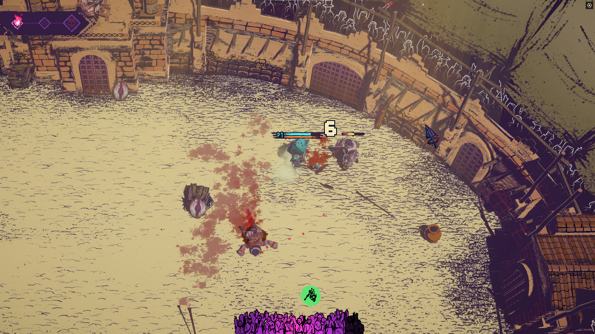
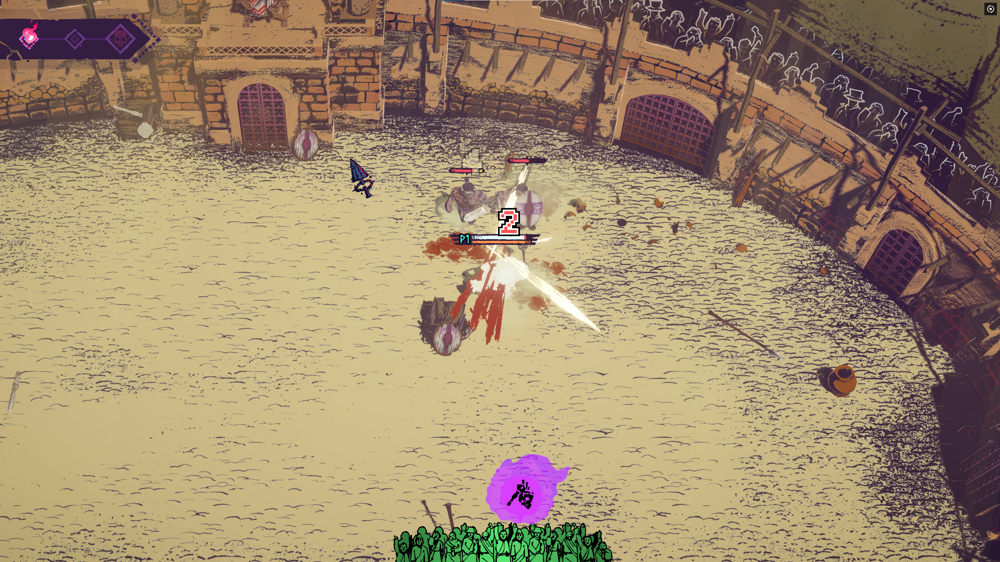

# Battle Numbers

Floating damage numbers for **Chained Beasts**. Pale yellow shows a player hurting an enemy; red shows an enemy hurting a player.

The numbers use the game's **Skranji HUD font**, with a **white inner outline and black outer outline**, plus a short pop, rise and fade. If that font isn't loaded, the original pixel digits are used instead. No game font files are bundled or changed.

**[Download 0.3.0 — awaiting multiplayer testing](https://github.com/Krrrrrrk/Chained-Beasts_Battle-Numbers/releases/tag/v0.3.0)** for **Chained Beasts 1.0.2 / Steam build 26231777**. The new all-player view is **awaiting multiplayer testing**.

Earlier versions have worked in my multiplayer tests. **The new 0.3.0 all-player view is still awaiting live multiplayer testing.** Builds and nongame checks pass; that does not establish in-game success.

## See friends' damage

0.3.0 adds **`ShowOtherPlayers = true`** by default, so I can see friends dealing and taking damage on my screen too. The host still measures actual HP lost; this only changes who receives and displays those cosmetic receipts. This update builds and passes nongame checks; the new all-player view still needs a manual multiplayer test. The [previous 0.2.2 release](https://github.com/Krrrrrrk/Chained-Beasts_Battle-Numbers/releases/tag/v0.2.2) remains available for the older own-hits view.

Use **0.3.0 on the host and on each PC that wants the all-player view**. Other players' hits are included even if they do not install Battle Numbers themselves. If other gameplay mods require matching installs, their requirements still apply. A 0.3.0 viewer connected to an older Battle Numbers host logs a warning and receives only the older own-hits view. Older viewers on a new host also retain their own-hits view.

The host's own `ShowOtherPlayers`, incoming and outgoing display preferences do not restrict what upgraded viewers can see. Set `ShowOtherPlayers = false` and restart to return to seeing only my own hits. Friendly/PvP damage is still excluded, and numbers outside the current camera view stay hidden.

## Screenshots

These screenshots show the older pixel digits. The current default uses the game's HUD font.

**Outgoing damage** — pale yellow numbers show HP lost by an enemy.



**Incoming damage** — red numbers show HP lost by my player.



## Download and install

Use the **0.3.0 release** for the new all-player view on game **1.0.2**. This feature is awaiting multiplayer testing. Version 0.2.2 remains available for the previous own-hits view; releases through 0.2.0 target game 1.0.1.

1. Install [BepInEx 6 build 791 — Windows x64 Unity IL2CPP](https://builds.bepinex.dev/projects/bepinex_be/791/BepInEx-Unity.IL2CPP-win-x64-6.0.0-be.791%2Bb782da4.zip) in your Chained Beasts game folder if you don't already have it.
2. Download [ChainedBeasts.BattleNumbers.dll](https://github.com/Krrrrrrk/Chained-Beasts_Battle-Numbers/releases/download/v0.3.0/ChainedBeasts.BattleNumbers.dll) from the [0.3.0 release](https://github.com/Krrrrrrk/Chained-Beasts_Battle-Numbers/releases/tag/v0.3.0).
3. With the game closed, put the DLL in `BepInEx/plugins/BattleNumbers/`. Create that folder if needed, and keep only one copy of the DLL.
4. Launch the game and start or join a run. For the all-player view, use 0.3.0 on the host and on your viewing PC.

This is standalone: Mod Foundation and Terms & Contusions are optional. It is cosmetic and does not change damage, health, combat, saves or network authority.

Inspected and built against Chained Beasts **1.0.2** (Steam build **26231777**), Unity **6000.3.21f1** and BepInEx **6.0.0-be.791+b782da4**. The mod disables itself on an uninspected GameAssembly build.

## Settings

First launch creates `BepInEx/config/local.chainedbeasts.battlenumbers.cfg`. Close the game before editing; restart to apply.

```ini
[Display]
Enabled = true
ShowOutgoing = true
ShowIncoming = true
ShowOtherPlayers = true
UseGameFont = true
TextScale = 1
Lifetime = 1
OutgoingColor = #FFF0A0
IncomingColor = #FF5555
```

Use `TextScale` to resize the numbers (0.5–2.5), and `Lifetime` to change their duration in seconds (0.25–3). Colors use `#RRGGBB`. Set `Enabled = false` to disable the mod. Optional diagnostic logging is off by default.

`UseGameFont = true` selects the native HUD font by default. Set it to `false` and restart to use the original pixel digits. The log reports when the HUD font is found, or when fallback rendering is needed. This setting only changes the appearance.

## Known issues and limits

- **0.3.0 is awaiting live multiplayer testing.** Please include both host and client logs if the new view fails.
- Some hits on bosses do not show damage numbers. I'm leaving that as a known issue for now; I'm not tackling boss-specific coverage.
- The all-player view requires **0.3.0 on the host and viewing PC**; the published 0.2.2 download retains the own-hits view. Foundation/Terms & Contusions remain optional.
- Friendly/PvP, environmental, internal/self and unattributed damage is excluded. Some status or area effects may not retain a usable attacker identity.
- Up to 96 numbers can be shown at once; extreme bursts replace the oldest numbers.

## Bug reports

If you submit a bug report, please attach your **`Player.log` from the session where the problem happened**. It helps me figure out what went wrong.

You can find it here on Windows:

```text
%USERPROFILE%\AppData\LocalLow\Featherweight Games\ChainedBeasts\Player.log
```

Please also mention what you were doing when it happened and which other mods you have installed.

## Build from source

Requires Windows, a .NET SDK that supports **net6.0**, and the installed game's BepInEx loader and generated `BepInEx/interop` assemblies.

```powershell
dotnet build src/ChainedBeasts.BattleNumbers/ChainedBeasts.BattleNumbers.csproj -c Release
```

For a nondefault game location, set `CHAINED_BEASTS_GAME_DIR` before building. The DLL is written to `src/ChainedBeasts.BattleNumbers/bin/Release/net6.0/`. Game binaries, loader dependencies and generated bindings are not included in this repository or release.

## Uninstall

With the game closed, remove `BepInEx/plugins/BattleNumbers/ChainedBeasts.BattleNumbers.dll`. Optionally remove `BepInEx/config/local.chainedbeasts.battlenumbers.cfg`. No save restoration is needed; leave other mods and the loader in place.

## License

[MIT](LICENSE). Small BepInEx/IL2CPP hook and component patterns were adapted from [Chained Beasts Mod Foundation](https://github.com/Krrrrrrk/chained-beasts-mod-foundation), also MIT licensed, copyright (c) 2026 Krrrrrrk. The fallback pixel digit designs are original; no game fonts or assets are bundled. This is an unofficial mod.
